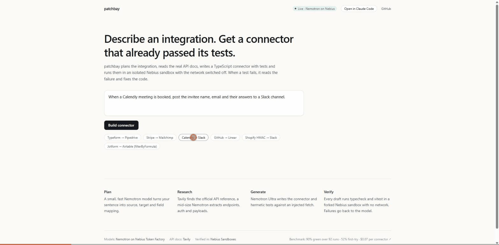

# patchbay




[](https://github.com/GodSmasher/patchbay/actions/workflows/ci.yml)
[](https://patchbay.openstatus.dev)
[](bench/RESULTS-variance.md)
[](docs/mcp-setup.md)
[](LICENSE)
[](https://tokenfactory.nebius.com)

### Works with

<p>
  <a href="docs/mcp-setup.md"></a>
  &nbsp;
  <a href="docs/mcp-setup.md"></a>
  <a href="docs/mcp-setup.md"></a>
  <a href="docs/slack-setup.md"></a>
  <a href=".github/workflows/patchbay-pr.yml"></a>
  <a href="Dockerfile"></a>
  <a href="https://patchbay-nebius.vercel.app"></a>
  <a href="https://www.npmjs.com/package/@patchbay-nebius/agent"></a>
</p>

**Describe an integration in one sentence. Get a tested TypeScript connector.**

```
patchbay build "When a Stripe payment succeeds, add the customer to a Mailchimp audience with the plan as a tag"
```

patchbay runs five steps:

1. **Plan** – a fast model turns the sentence into source/target apps, trigger, action, docs queries, field mapping. Nemotron 3.5 Lightning.
2. **Research** – Tavily search + extract, biased toward each vendor's own domain, feeding a mid-tier model that produces a normalized API spec (endpoints, auth, example payloads). Nemotron 3 Super.
3. **Generate** – a strong model writes `src/connector.ts`, `src/connector.test.ts` and `README.md`. Nemotron 3 Ultra, 32k tokens, temperature 0.1.
4. **Verify** – a Nebius Token Factory sandbox installs TypeScript + vitest once (checkpointed), then every attempt forks that checkpoint with the generated files and networking disabled. `tsc --noEmit` and `vitest run` are the gate.
5. **Repair** – when a run is red, the strong model gets the file blocks and the failed test output, and tries again. Up to `PATCHBAY_MAX_ATTEMPTS` times (default 3). Optional parallel mode generates N variants at once, verifies them in parallel sandbox forks, keeps the first green.

Every endpoint in the spec comes with an example payload taken from the documentation; the generated test harness runs the connector against that payload (the "contract" check), so a run only counts as green when the generated code actually works with the shape the real API returns.

## Three ways to call it

**CLI** – [`@patchbay-nebius/agent`](https://www.npmjs.com/package/@patchbay-nebius/agent) on npm

```
npx -y @patchbay-nebius/agent build "When a Stripe payment succeeds, add the customer to a Mailchimp audience"
# or
npm install -g @patchbay-nebius/agent
patchbay build   [--record] "<one-sentence integration>"
patchbay research           "<one-sentence integration>"
patchbay verify  <directory>
```

**MCP server** – [`@patchbay-nebius/mcp`](https://www.npmjs.com/package/@patchbay-nebius/mcp) on npm, stdio transport.

Three tools (`build_connector`, `research_api`, `verify_code`) with live progress and logging notifications.

```
claude mcp add patchbay -- npx -y @patchbay-nebius/mcp
```

Full setup for Claude Code, Codex and Cursor in [docs/mcp-setup.md](docs/mcp-setup.md).

**Web app** – `apps/web`, Next.js 14 on port 3400. Live demo at **https://patchbay-nebius.vercel.app**. The same UI streams a live Nebius run or, past the 6/hour per-IP rate limit, the recorded replay. Public uptime at **https://patchbay.openstatus.dev**.

**Slack** – `/patchbay <one-sentence integration>` as a slash command. Setup in [docs/slack-setup.md](docs/slack-setup.md); the endpoint lives at `apps/web/app/api/slack/command/route.ts` on the same Vercel deploy.

**GitHub PR** – comment `/patchbay build "<integration>"` on any PR and the workflow in `.github/workflows/patchbay-pr.yml` runs the full pipeline, attaches the generated connector as an artifact and replies with the test score. Needs the three Nebius / Tavily secrets configured in the repo.

## Why not just ask Claude Code / Cursor / Codex yourself?

Same connector, same requirements. Rough per-connector cost:

| Where | Cost | Factor |
|---|---|---|
| **patchbay** (Nemotron on Nebius) | **~$0.07** | 1× |
| Claude Code with Haiku 5.5 | ~$0.10 | 1.4× |
| Claude Code with Sonnet 5.5 | ~$0.35 | 5× |
| Claude Code with Opus 4.7 | ~$1.90 | **27×** |

**$0.07 vs ~$1.90 for the same connector. And the tests actually run before you see the file.**

The agent in your IDE is a generalist. For integration connectors — read the docs, map fields, write the thing, prove it works — that's work with hard structure, and a specialized pipeline on cheap models beats a general-purpose agent on expensive ones. Same reason you don't ask Opus to format JSON.

**patchbay sits inside your editor as an MCP server** (`claude mcp add patchbay -- npx -y @patchbay-nebius/mcp`), so you keep using Claude Code / Cursor / Codex for everything else — architecture, refactors, bug hunts — and offload connector work to patchbay. Your Claude usage bill goes down for the task Claude is slowest *and* most expensive at.

The generated connector is **plain TypeScript in your repo**, no runtime dependency on patchbay — read it, change it, ship it.

## Selfhost

```bash
git clone https://github.com/GodSmasher/patchbay
cd patchbay
cp .env.example .env.local            # fill in NEBIUS + TAVILY keys
docker compose up --build
# open http://localhost:3400
```

The Dockerfile is a three-stage build (deps → build → runtime) producing a ~90 MB image around Next.js's standalone server. docker-compose.yml wires the env vars through from `.env.local`; without live keys the web app streams the recorded replay instead.

## Build in public

What broke this week and how it got fixed is in [docs/build-log.md](docs/build-log.md). Short version: nested-contract regex (+2 benchmark points), parallel-repair fiasco (reverted), monotonic repair (never regress past the best attempt), timestamp prompt (don't reject the documented example), esbuild preflight (first-try rate 33% → 52%), Vercel monorepo pain (three fixes, one deploy).

## Training a repair model on our own benchmark runs

Every patchbay benchmark run is a record of the agent failing and then fixing itself. 68 of those `(red draft + failing test report) → green draft` moments across five benchmark passes make a tiny but perfectly-domain-matched training set — and Nebius Token Factory ships an OpenAI-compatible fine-tune endpoint that eats exactly this format.

So we're fine-tuning a repair-focused **Nemotron 3.5 Lightning** on patchbay's own repair history. If it matches **Nemotron 3 Ultra 550B** (patchbay's current repair model) on the held-out eval set, we close the loop: patchbay generates benchmark runs → runs train its own repair model → next benchmark's repair cost drops ~50× while the green rate holds. The dataset, launcher and eval harness are all in-repo:

- `bench/training-data.jsonl` — 68 real red→green repair pairs, extracted from committed benchmark runs
- `scripts/finetune.ts` — upload / start / watch Nebius fine-tune jobs
- `scripts/eval-repair.ts` — format, file-coverage and line-overlap metrics against a held-out eval split
- Full plan + numbers (as they come in): [docs/finetune.md](docs/finetune.md)

## Status

Live benchmark (2026-10-21, Nebius sandbox, 53 runs after all recent agent patches):

- **Core 20 prompts** (Typeform → Pipedrive, Shopify → Airtable, Stripe → Mailchimp, …): **80% green · 40% first-try · $0.12/connector**
- **Brutal 10 extensions** (WebSocket to Pusher, OAuth2 refresh, chained flows, S3 presigned URL, GraphQL nested mutations, HMAC-signed server events): **69% green · 23% first-try · $0.17/connector**
- **Overall**: **77% green · 36% first-try · $0.13/connector**

The 2026-10-06 run on the 20-prompt core — 5 full passes, 90.2% green, $0.07/connector — is still in [bench/RESULTS-variance.md](bench/RESULTS-variance.md) for the longer-horizon variance picture. This October 21 run adds the brutal 10 to the same bench and shows what happens when you point patchbay at the harder half of the real integration zoo.

The pre-sandbox esbuild parse check, parallel repair branches (temperatures 0.1 / 0.4), monotonic repair (never regress past the best attempt so far), undici-level retry on `UND_ERR_SOCKET` / `fetch failed`, and the `RETRY SEMANTICS` + `CURSOR PAGINATION` rules in the generate prompt are what make the brutal 10 reach 69% instead of ~40%.

## Dev

```
npm install
cp .env.example .env.local            # fill in NEBIUS_API_KEY, NEBIUS_AI_PROJECT, TAVILY_API_KEY

npm test                              # vitest, replay mode, no keys needed
npm run typecheck                     # tsc across workspaces
npm run check:nebius                  # auth probe for inference + sandboxes + Tavily
npm run patchbay -- build "..."       # live run (needs keys)
npm run patchbay -- help              # all commands and flags
npm run bench                         # the 10-prompt benchmark
npm run dev                           # Next.js app on :3400
npm run mcp                           # start the MCP server on stdio
```

## Environment

See [`.env.example`](.env.example). Key knobs:

| Variable | Default | What it does |
|---|---|---|
| `PATCHBAY_MOCK` | `true` | Replay mode. Set to `false` for live runs. |
| `PATCHBAY_RUNNER` | `nebius` | `nebius` (isolated sandbox) or `local` (dev fallback). |
| `PATCHBAY_MAX_ATTEMPTS` | `3` | Repair-loop cap. |
| `PATCHBAY_PARALLEL_REPAIRS` | `1` | N parallel repair branches per attempt (max 4). Best-of-N. |
| `PATCHBAY_MODEL_FAST / MID / STRONG` | nvidia/Nemotron 3.5 Lightning / 3 Super / 3 Ultra | Model tiers. Any OpenAI-compatible base URL works. |

The generated connector has **zero patchbay dependency** – it's a plain TypeScript file your project can drop in anywhere.

## Repo layout

```
packages/
  agent/   # the pipeline (plan, research, generate, verify, repair) + CLI
  mcp/     # MCP server exposing build_connector / research_api / verify_code
apps/
  web/     # Next.js demo
bench/     # the 10-prompt benchmark + results
docs/      # setup guides
runs/      # recorded live runs (gitignored)
```

## Deploy

The web demo is a Next.js app with one SSE route (`/api/run`). An in-memory IP rate limit caps live runs at `PATCHBAY_MAX_RUNS_PER_HOUR` (default 6) per hour and silently falls back to the recorded replay when exceeded, so a hug-of-death doesn't burn through credits. For Vercel: `apps/web/vercel.json` pins the route's function to a 300s timeout (needs a Pro plan; on Hobby, add `?replay=1` or set `PATCHBAY_MOCK=true` to keep every call under 10s).

---

Built for the [Nebius × NVIDIA Global AI Hackathon](https://nebiusglobalaihackathon.devpost.com). Track: Coding & Agentic Engineering.
